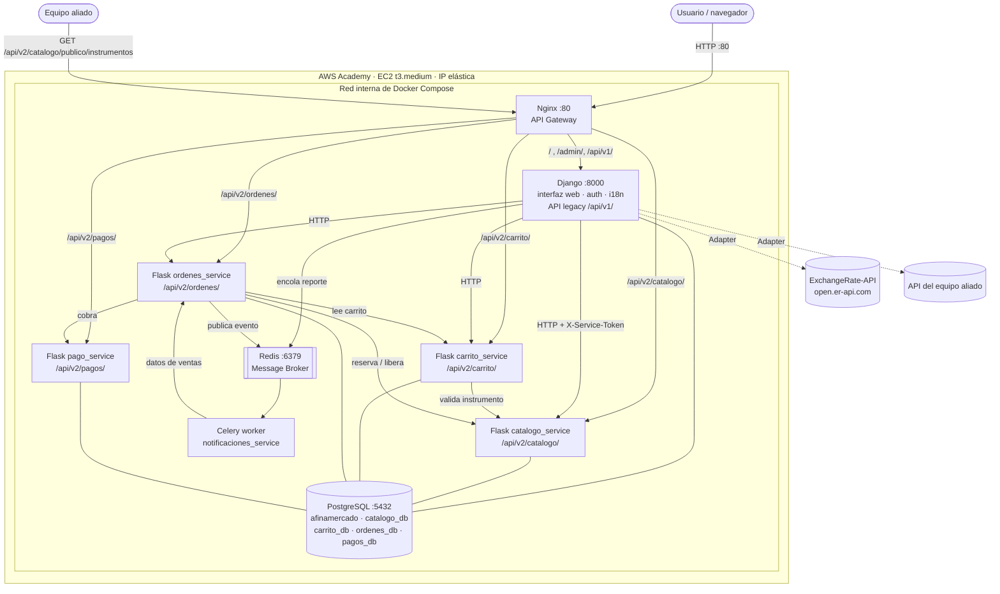
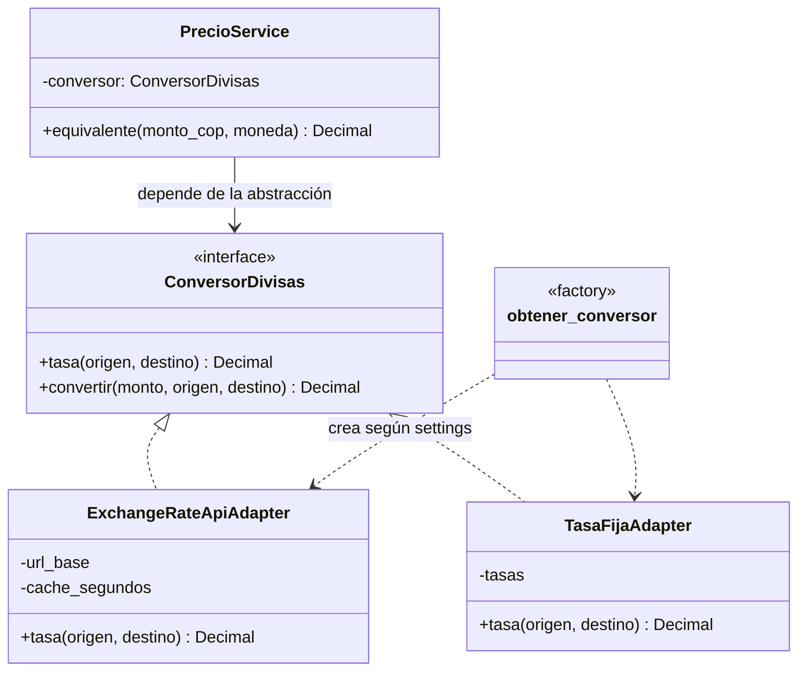
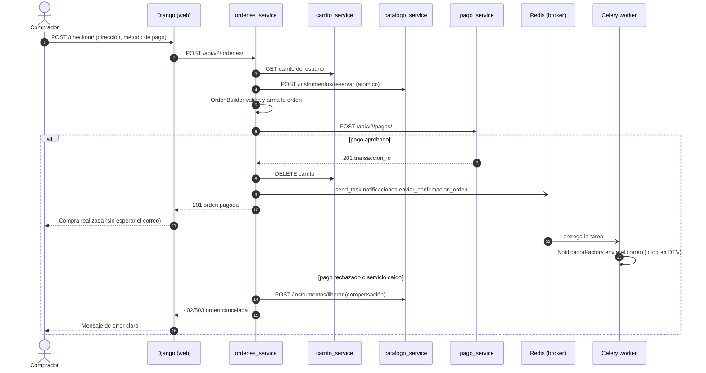

# Entrega 2: Migración a Microservicios, Integración y Resiliencia

AfinaMercado pasó de un monolito Django a un ecosistema híbrido: Django queda como interfaz web
(autenticación, plantillas, i18n) y la lógica de negocio vive en **cuatro microservicios Flask** y un
**worker Celery**, todos detrás de **Nginx como API Gateway**, desplegados con **Docker Compose** en
una instancia **EC2 de AWS Academy**.

- Guía de despliegue: [`docs/DESPLIEGUE_AWS.md`](https://github.com/Danimuneton/AfinaMercado/blob/main/docs/DESPLIEGUE_AWS.md)
- Contrato de la API pública: [`docs/API_PUBLICA.md`](https://github.com/Danimuneton/AfinaMercado/blob/main/docs/API_PUBLICA.md)
- Antecedente: [Migración a Microservicios (Strangler Pattern) - Taller 2](https://github.com/Danimuneton/AfinaMercado/wiki/Migraci%C3%B3n-a-Microservicios-%28Strangler-Pattern%29--Taller-2)

---

## 1. Arquitectura de despliegue (AWS + Nginx + Flask + Broker)



Solo el puerto **80 (Nginx)** está abierto en el security group de AWS. Django, los microservicios,
PostgreSQL y Redis solo son accesibles dentro de la red de Docker.

### Contenedores

| Contenedor | Tecnología | Responsabilidad | Base de datos |
|---|---|---|---|
| `nginx` | Nginx 1.27 | API Gateway: enruta por URL, límite de peticiones, errores JSON | — |
| `django_web` | Django 5.2 | Interfaz web, autenticación, i18n, integraciones (Adapter), API legacy v1 | `afinamercado` |
| `flask_catalogo_service` | Flask 3 | Vendedores, categorías, instrumentos, reserva atómica, API pública | `catalogo_db` |
| `flask_carrito_service` | Flask 3 | Carrito de compras por usuario | `carrito_db` |
| `flask_ordenes_service` | Flask 3 | Órdenes, líneas, envíos (Builder), coordinación de la compra | `ordenes_db` |
| `flask_pago_service` | Flask 3 | Procesamiento y registro de pagos (pasarela simulada) | `pagos_db` |
| `notificaciones_worker` | Celery 5.5 | Notificaciones de compra (Factory) y reporte de ventas | — |
| `redis` | Redis 7 | Message Broker y backend de resultados de Celery | — |
| `db` | PostgreSQL 16 | Una base de datos por servicio (*database per service*) | — |

---

## 2. Matriz de decisión (Strangler Pattern) y bono del 70 %

En el Taller 2 se extrajo **Pagos**. En esta entrega se continuó estrangulando el monolito con los
mismos criterios:

| Módulo | Carga CPU | Frecuencia de cambio | Acoplamiento | Decisión | Dónde vive ahora |
|---|---|---|---|---|---|
| Pagos | Alta | Alta | Bajo | Estrangular (Taller 2) | `pago_service` (Flask) |
| Catálogo de instrumentos | Media | Media | Medio | Estrangular | `catalogo_service` (Flask) |
| Vendedores | Baja | Baja | Medio | Estrangular junto a Catálogo | `catalogo_service` (Flask) |
| Categorías | Baja | Baja | Medio | Estrangular junto a Catálogo | `catalogo_service` (Flask) |
| Carrito | Media | Media | Bajo | Estrangular | `carrito_service` (Flask) |
| Órdenes | Alta | Media | Alto → Bajo* | Estrangular | `ordenes_service` (Flask) |
| Envíos | Baja | Media | Bajo | Estrangular junto a Órdenes | `ordenes_service` (Flask) |
| Notificaciones | Alta (E/S) | Media | Bajo | Estrangular a tarea asíncrona | `notificaciones_worker` (Celery) |
| Reportes de ventas | Muy alta | Media | Bajo | Estrangular a tarea asíncrona | `notificaciones_worker` (Celery) |
| Autenticación de usuarios | Baja | Baja | Alto | **Mantener en Django** | Django |
| Integraciones externas (divisas, aliado) | Baja | Media | Bajo | **Mantener en Django** (capa de presentación) | Django (Adapter) |

\* Órdenes estaba acoplado por llaves foráneas a `Instrumento` y `User`. Se desacopló guardando una
copia de los datos del instrumento en cada línea (marca, modelo, categoría, vendedor, precio) y el
`usuario_id` como entero. Así `ordenes_db` no depende de las tablas de otros servicios.

**Resultado:** 9 de los 11 módulos de negocio (**82 %**) se ejecutan en microservicios Flask o en el
worker Celery, cada uno con su propio contenedor, su propio `Dockerfile` y su propia base de datos.
Django conserva la autenticación, la interfaz web y la API legacy `/api/v1/`. La v1 se mantiene
solo por compatibilidad: la interfaz web ya no la usa y todo el tráfico de la aplicación pasa
por `/api/v2/`. Es el paso final del Strangler Pattern antes de retirar la ruta antigua.

---

## 3. API Gateway (Nginx)

| Ruta | Destino | Límite |
|---|---|---|
| `/api/v2/catalogo/` | `flask_catalogo_service:5000` | 20 r/s por IP (ráfaga 40) |
| `/api/v2/carrito/` | `flask_carrito_service:5000` | 20 r/s (ráfaga 40) |
| `/api/v2/ordenes/` | `flask_ordenes_service:5000` | 20 r/s (ráfaga 20) |
| `/api/v2/pagos/` | `flask_pago_service:5000` | 20 r/s (ráfaga 20) |
| `/api/v2/` | Índice JSON de los servicios del gateway | — |
| `/`, `/admin/`, `/api/v1/` | `django_web:8000` (interfaz y monolito legacy) | — |

Decisiones del gateway:

- **Resolución DNS por petición** (`resolver 127.0.0.11`): Nginx arranca aunque un microservicio
  esté caído y no hay que reiniciarlo cuando un contenedor cambia de IP.
- **Error JSON estructurado** (`error_page 502 503 504`): si un microservicio no responde, el cliente
  recibe `503 {"error":"servicio_no_disponible", ...}` con `Retry-After`, en vez de la página HTML de Nginx.
- **Rate limiting** (`limit_req`): responde `429` ante abuso, protegiendo a los servicios.
- Cabeceras `X-Forwarded-*`, `server_tokens off`, `gzip` para JSON.

---

## 4. Servicios (integración y patrones estructurales)

### 4.1 Servicio a proveer

`GET /api/v2/catalogo/publico/instrumentos` (microservicio de Catálogo). JSON con los instrumentos
disponibles, sin autenticación y con CORS abierto para que el equipo aliado lo consuma.
Contrato completo en [`docs/API_PUBLICA.md`](https://github.com/Danimuneton/AfinaMercado/blob/main/docs/API_PUBLICA.md).

### 4.2 Servicio a consumir (equipo aliado)

Página **Equipo aliado** (`/aliado/`). La URL del aliado se configura con las variables
`ALIADO_API_URL` y `ALIADO_NOMBRE` del `.env`, sin tocar código. El adaptador `AliadoHttpAdapter`
(`web/integraciones/aliado.py`) acepta una lista JSON o un objeto con la lista dentro (`results`,
`data`, `items`, ...) y la convierte en una tabla. Si el aliado no responde, la página lo informa y
el resto del sitio sigue funcionando.

### 4.3 API de terceros con patrón Adapter (inversión de dependencias)

Los precios se muestran en COP y su equivalente en USD, con la tasa del día de
[ExchangeRate-API](https://www.exchangerate-api.com) (`open.er-api.com`, sin API key).



- **Puerto:** `ConversorDivisas` (`web/integraciones/divisas.py`). Es lo único que conoce el caso de uso `PrecioService`.
- **Adaptador:** `ExchangeRateApiAdapter` traduce la respuesta del proveedor
  (`{"result":"success","rates":{...}}`) a `tasa(origen, destino)`. Guarda las tasas en caché por 1 hora.
- **Inversión de dependencias:** `PrecioService` recibe el conversor por constructor. Cambiar de
  proveedor es escribir otro adaptador y cambiar `DIVISAS_PROVEEDOR` en el `.env`.
  `TasaFijaAdapter` permite trabajar sin internet.
- **Resiliencia:** si el proveedor falla, `PrecioService` devuelve `None` y la interfaz muestra
  "Precio en dólares no disponible", sin romper la página.

---

## 5. Comunicación asíncrona (Celery + Redis)



| Tarea | Quién la encola | Qué hace |
|---|---|---|
| `notificaciones.enviar_confirmacion_orden` | `ordenes_service` al pagar | Arma el correo en el idioma del comprador y lo envía con `NotificadorFactory` (SMTP en `PROD`, log en `DEV`). Reintenta 3 veces con espera exponencial |
| `reportes.generar_reporte_ventas` | Django (página **Reportes**, solo administradores) | Consulta las ventas a `ordenes_service`, calcula ingresos, ticket promedio y ventas por categoría y método de pago. La página se actualiza sola hasta mostrar el resultado |

Si Redis no está disponible, la compra se completa igual (`notificacion_encolada: false`) y el
error queda en el log.

---

## 6. Resiliencia

Comportamientos verificados con pruebas de extremo a extremo antes de entregar:

| Falla | Comportamiento |
|---|---|
| Microservicio de Pagos caído durante una compra | La orden queda `cancelada` con el motivo, los instrumentos se **liberan** (compensación) y el usuario ve un mensaje claro |
| Dos compradores con el mismo instrumento | La reserva en Catálogo es atómica (`SELECT ... FOR UPDATE`). El segundo recibe `409` "Ya no están disponibles" |
| Microservicio de Catálogo caído | La web muestra "El catálogo no está disponible en este momento" (sin error 500). Nginx responde `503` JSON a los clientes de la API |
| API de divisas caída | Se muestra solo el precio en COP |
| API del aliado caída | La página del aliado lo informa y el resto del sitio funciona |
| Redis caído | La compra se completa y la notificación no se encola |
| Datos inválidos | `400` con `error`, `detalle` y `campos` por campo; la web los muestra junto a cada campo del formulario |
| Petición sin token entre servicios | `401` (solo los servicios internos conocen `SERVICE_TOKEN`) |
| Contenedor que se reinicia | `restart: unless-stopped`, healthchecks y `depends_on: service_healthy` |

Formato de error común de todos los microservicios:

```json
{ "error": "solicitud_invalida", "detalle": "Datos de instrumento inválidos.", "campos": { "precio_base": "El precio debe ser mayor que 0." } }
```

---

## 7. Internacionalización (i18n con gettext)

- **Idiomas:** español (predeterminado) e inglés, con un selector en el menú (`set_language` de Django).
- **Django:** `LocaleMiddleware`, `` / `` en todas las plantillas
  y `gettext` / `gettext_lazy` en vistas, formularios y modelos (incluido el módulo legacy `ordenes`).
  Catálogos en `locale/es` y `locale/en` (`django.po`), compilados con `compilemessages` en la imagen Docker.
- **Microservicios Flask:** Flask-Babel (gettext). Cada servicio tiene `translations/es` y
  `translations/en` y elige el idioma con la cabecera `Accept-Language`, que Django reenvía en cada
  llamada. Así los errores que llegan de un microservicio también salen en el idioma del usuario.
- **Worker:** los correos se generan con los catálogos gettext del worker en el idioma del comprador.
- Los microservicios devuelven **códigos estables** (`pagada`, `excelente`, `en_camino`) y la
  interfaz los traduce (`web/etiquetas.py`). No hay textos quemados en la interfaz.
- Los precios se formatean según el idioma (`$ 4.200.000` en español, `$ 4,200,000` en inglés).

---

## 8. Auditoría de UI/UX

| Heurística (Nielsen) | Implementación |
|---|---|
| Visibilidad del estado del sistema | Mensajes de éxito/error después de cada acción, contador del carrito en el menú, estado de la orden y del envío con colores, spinner mientras se genera el reporte |
| Coincidencia con el mundo real | Precios en COP con su equivalente en USD, estados en lenguaje natural y en el idioma del usuario |
| Control y libertad del usuario | Quitar del carrito (con confirmación), "Seguir comprando", "Quitar filtros", "Cancelar" en formularios, migas de pan |
| Consistencia y estándares | Bootstrap 5 en todo el sitio, mismo componente para todos los campos de formulario (`_campo.html`) |
| Prevención de errores | Validación en Django y en el microservicio, botón de pago deshabilitado tras el primer clic (evita pagar dos veces), no se puede comprar un instrumento propio ni uno vendido |
| Reconocer antes que recordar | Menú con la sección activa resaltada, categorías como lista desplegable, métodos de pago como opciones |
| Ayuda para recuperarse de errores | Errores junto a cada campo (`is-invalid`, `aria-invalid`), páginas 403/404/500 propias con enlace de regreso |
| Diseño minimalista | Tarjetas con lo esencial (marca, modelo, condición, precio) y el detalle aparte |
| Accesibilidad | Enlace "Saltar al contenido", `aria-label` en navegación, etiquetas `<label>` en todos los campos, `fieldset/legend` en opciones, foco visible, diseño responsive |

---

## 9. Seguridad

- Secretos (`DJANGO_SECRET_KEY`, contraseña de PostgreSQL, `SERVICE_TOKEN`) en `.env`, que no se sube al repositorio. Django se niega a arrancar con `DEBUG=False` sin `DJANGO_SECRET_KEY`.
- Llamadas entre servicios autenticadas con `X-Service-Token` (comparación en tiempo constante).
- Cada usuario solo ve su carrito y sus órdenes (filtro por `usuario_id` en los microservicios).
- Reportes solo para administradores (`403` para los demás).
- Contenedores de Django y del worker sin usuario root. Solo el puerto 80 queda expuesto en AWS.

---

## 10. Cómo ejecutarlo

```powershell
Copy-Item .env.example .env      # y editar los valores
docker compose up -d --build
Start-Process "http://localhost:8080/"
```

En AWS se sigue la [guía de despliegue](https://github.com/Danimuneton/AfinaMercado/blob/main/docs/DESPLIEGUE_AWS.md) (`NGINX_PORT=80`).
